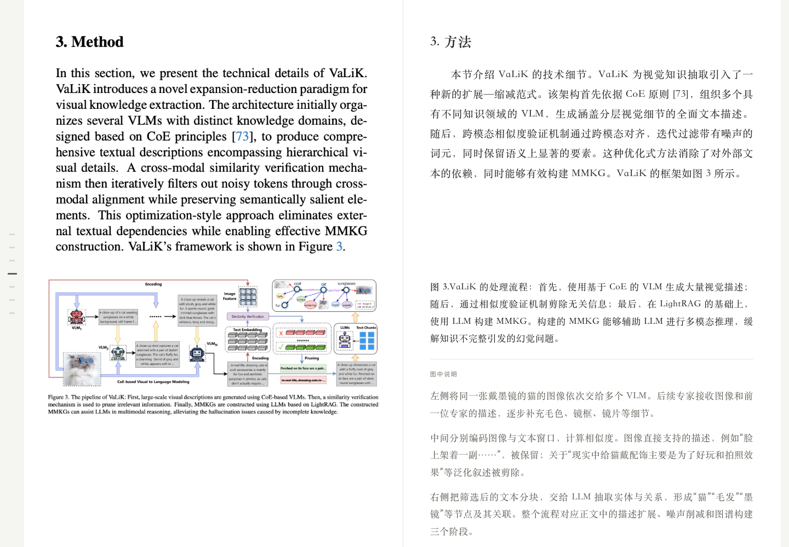
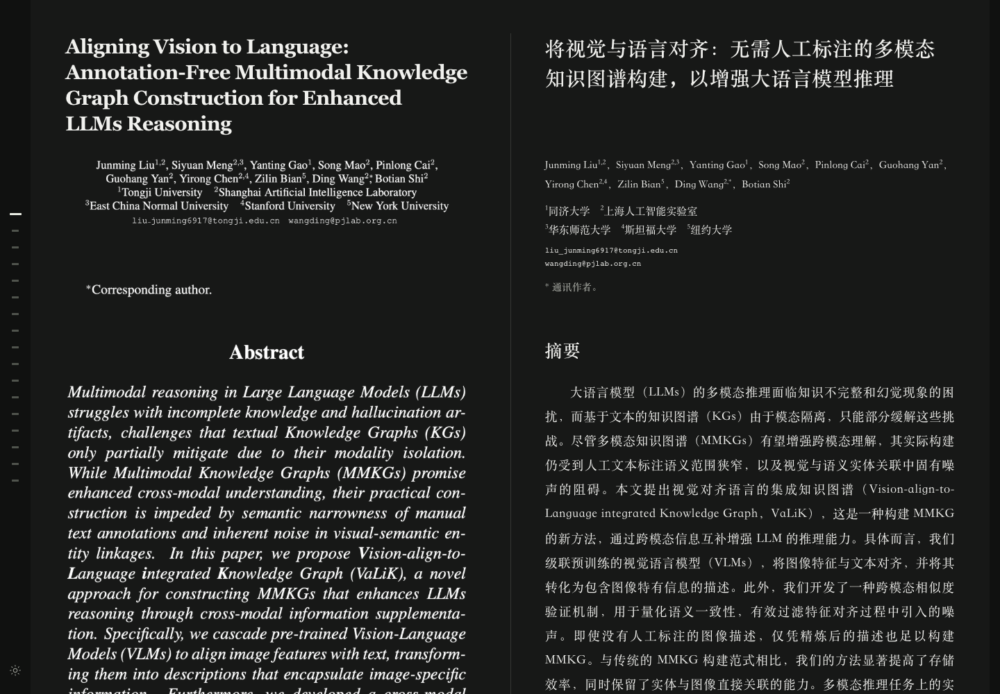

# paper-bilingual-web

将论文 PDF 制作成原文在左、忠实中文译文在右的逐段对照网页的通用 Agent Skills 技能。

## 安装

将仓库克隆到 `~/.agents/skills/`：

```bash
git clone https://github.com/Leo-FDUAICS/paper-bilingual-web.git ~/.agents/skills/paper-bilingual-web
```

也可下载源码 ZIP，解压后把整个技能文件夹放入该目录，并命名为 `paper-bilingual-web`。Windows 对应 `%USERPROFILE%\.agents\skills\paper-bilingual-web\`。

## 使用

在支持 Agent Skills 的代理工具中提供论文 PDF，并要求使用 `paper-bilingual-web` 将其制作成中英对照网页。支持显式技能引用的工具可直接输入：

```text
用 $paper-bilingual-web 把这些论文制作成中英对照网页。
```

默认逐段忠实翻译，保留原始公式、原图原表和段落布局；图表配中文图注与解释；左侧完整保留参考文献，右侧不译，附录正常翻译。正文左右等宽，共享页面滚动。左侧以短横线刻度对应论文大标题，支持点击跳转、悬停显示章节名、滚动高亮当前章节和键盘操作；仅另设简洁的明暗切换按钮。

正文段落悬停时，原文与译文同时轻微高亮。阅读位置保存在当前浏览器，刷新或重新打开时自动续读，各篇论文独立记录；新打开的章节链接定位指定章节，刷新当前页面则恢复最新阅读位置。

支持亮色与暗色模式，以纯 SVG 线条太阳／月亮按钮切换，采用约 320ms 的渐变动画。暗色下文字为浅色、背景为黑色／深灰；源文仍使用 PDF 裁切，只调整文字裁切的显示，图表与图片保持原色。主题在浏览器记忆，支持系统偏好与减少动态效果设置。

辅助脚本依赖 Python 3、`pdfplumber` 和 `Pillow`。数据格式和脚本用法见 [references/blocks.md](references/blocks.md)，完整工作流程见 [SKILL.md](SKILL.md)。输出为可离线打开的静态网页，也可使用当前环境的静态站点工具发布。





## 版本

- [v1.0.0](https://github.com/Leo-FDUAICS/paper-bilingual-web/tree/v1.0.0)：原始双栏版本。
- [v1.1.0](https://github.com/Leo-FDUAICS/paper-bilingual-web/tree/v1.1.0)：增加左侧章节刻度导航。
- [v1.2.0](https://github.com/Leo-FDUAICS/paper-bilingual-web/tree/v1.2.0)：增加阅读位置记忆与双栏段落联动高亮。

- [v1.3.0](https://github.com/Leo-FDUAICS/paper-bilingual-web/tree/v1.3.0)：增加保留图表原色的暗色模式与渐变切换；参考文献完整保留原文、右侧不译。
